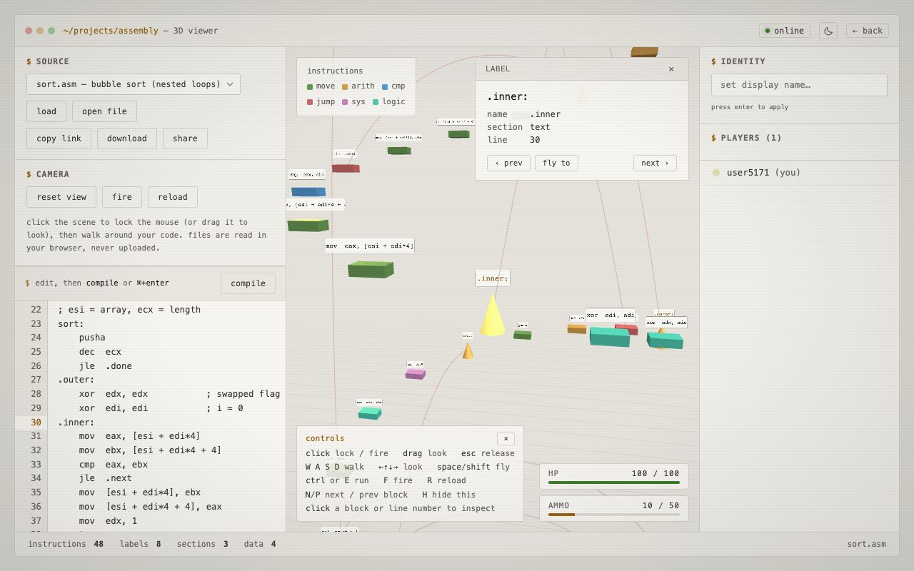

# Assembly FPS

Drop an `.asm` file into the browser and walk around your code in 3D.
Instructions become a tower of blocks you can fly through — and shoot,
because at some point this turned back into a game. If someone else is
on the page at the same time, it's multiplayer: you can see each other
flying around and trade shots.

Live at [j4den.com/assembly](https://j4den.com/assembly).



## Running it locally

```bash
npm install
npm run dev         # http://localhost:3001
```

`npm test` runs the parser tests. The scene boots with the hello-world
sample so it isn't empty; the picker in the sidebar has a few more (loops
with local labels, 64-bit string ops, `gcc -S` output, a bubble sort), or
drop one of your own `.asm` files onto the page. The local server also
runs the multiplayer relay on `/ws`, so two browser tabs on localhost
can see each other.

## Controls

- **Click** the page to lock the mouse and look around (or **drag** to look
  if your browser blocks mouse lock)
- **WASD** — move, **arrow keys** — look, **Space / Shift** — up / down,
  **Ctrl or E** — run
- **Click a block or a line number** — select it, open the detail panel,
  and glide the camera over to it
- **N / P** — next / previous block in program order (the detail panel has
  the same buttons, plus *fly to*)
- **Click empty space or F** — shoot, **R** — reload
- **Esc** — release the mouse, **H** — show / hide the controls panel
- **Ctrl+Enter** (⌘+Enter on a Mac) in the editor — compile
- On a phone: drag to look, tap a block to inspect, and use the on-screen
  pad to walk, fly and shoot

Files you open or drop are read in the browser with `FileReader` and never
uploaded. NASM-style `.asm` and GAS-style `.s` (e.g. `gcc -S` output) both
work; files over 3000 lines are cut off so the view stays smooth.

## Editor

The editor has a line-number gutter that stays in step with the 3D view:
selecting a block highlights its line, and clicking a line number selects
its block. A jump to a label that isn't in the file (usually a typo) turns
that line number red and shows up as *unresolved* in the stats bar —
`extern` names and GAS `foo@PLT` calls are left alone.

**copy link** puts the source in the page address (deflated, then
base64) and copies it, so a program can be shared with a URL and nothing
ever touches a server. **download** saves whatever is in the editor as a
file. **share** pushes the code to everyone in the multiplayer room.

## Light and dark

The sun / moon button in the title bar switches the theme. It uses the
same `localStorage.theme` key as the rest of j4den.com, so the choice
carries across the site, and with nothing saved it follows the device.
Block colors stay the same in both themes so the legend keeps its
meaning; the backdrop, fog, grid and the text chips on each block are
redrawn in place.

## How the layout works

Instructions are grouped by section (`.text`, `.data`, …) and each
section spirals around its own column so you can walk between them.
Jumps are drawn as arcs from the `jmp` to the label it targets, so you
can see control flow at a glance. Color roughly means instruction
category: data movement (`mov`, `push`, …), arithmetic, compares,
jumps/calls, and system instructions (`int`, `syscall`) each get their
own color, and section markers are their own thing. GAS mnemonics with a
size suffix (`movl`, `pushq`) are colored by their base opcode.

## Multiplayer

The client speaks a small JSON wire format over WebSocket: position
updates, shots, and hits. Locally that's handled by the relay in
`server.js`; on the live site the same protocol is served by a
Cloudflare Durable Object worker, so the client connects to whichever
one matches the host it's on. The server is authoritative for damage —
remote projectiles are visual-only on your end, which keeps hits from
being double-counted. The relay rate-limits each session so one client
can't flood the room with shots or code pushes, and the client caps live
projectiles for the same reason.

## Files

```
server.js            Static file server + WebSocket relay (plain node:http + ws)
sample.asm           Example input
test/                Parser tests (node --test)
docs/screenshot.jpg  The picture above
public/
  index.html         UI shell, editor + gutter, HUD, theme toggle, share link
  engine.js          Three.js scene, controls, combat, multiplayer client
  parser.js          .asm → instruction list (labels, sections, jump targets)
  samples.js         The built-in sample programs
  vendor/three.min.js
```
